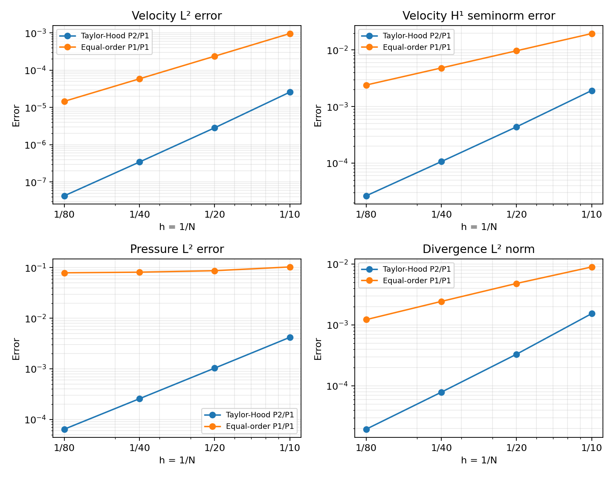
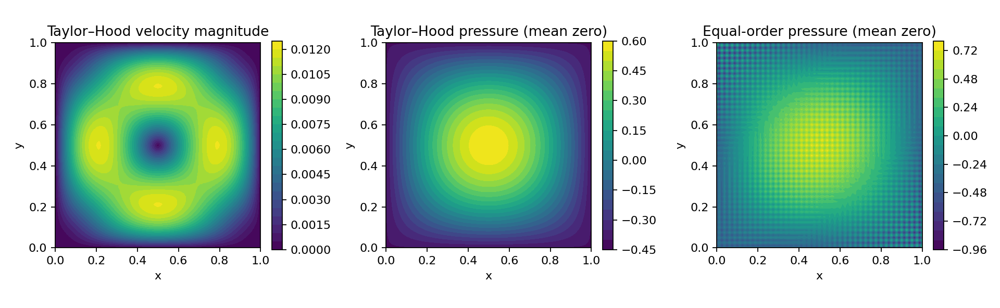

# Stokes finite-element convergence study

**How does a stable velocity–pressure pair behave under mesh refinement, and what goes wrong with an equal-order pair?** A manufactured-solution study comparing Taylor–Hood P2/P1 and unstabilized P1/P1 elements on the stationary incompressible Stokes problem.

Jihad Boussata · FreeFEM · Python · mixed finite elements · numerical verification



## Verified findings

| Taylor–Hood error | N=80 | Final observed rate |
| --- | --- | --- |
| Velocity L² | 4.254e-08 | 3.01 |
| Velocity H¹ seminorm | 2.642e-05 | 2.01 |
| Pressure L² | 6.428e-05 | 2.00 |

The observed rates approach 3, 2 and 2 on this smooth manufactured solution. Equal-order pressure L² error is 7.918e-02 at N=80 and exhibits little improvement on the finest meshes. A tiny pressure-mass penalty fixes the near-singular system numerically; it does **not** supply an inf-sup stability guarantee or a consistent equal-order stabilization method.



## Reproduce

Install FreeFEM (validated with 4.13) and Python 3.12. On Ubuntu, `sudo apt-get install freefem++`. Activate a virtual environment and run:

```bash
python -m pip install -r requirements.txt
python -m unittest discover -s tests -v
python scripts/run.py
```

Defaults run N=10,20,40,80 for each element pair. Use `--meshes 8 16` for a small smoke study, `--output another-directory` for a separate run, or `--freefem /path/to/FreeFem++`. Numerical tests are skipped if the executable is absent; the configured CI installs it. Tests were run with the solver present for the committed analysis.

Outputs include [convergence.csv](results/convergence.csv), nodal fields, parameters and plots. Per-run generated scripts/logs are kept locally under `results/runs/` and git-ignored.

## Problem and verification

Solve −νΔu + ∇p=f, ∇·u=0 in the unit square, with no-slip velocity on the boundary. A polynomial streamfunction defines an exactly divergence-free velocity; p=sin(πx)sin(πy)−4/π² has zero mean. The forcing is derived analytically from that exact solution. Pressure is normalized after each solve, and errors use higher-order quadrature.

Tests verify Taylor–Hood refinement, zero-mean pressure and the stated degree-of-freedom counts. Total DOFs include prescribed boundary velocity values; free velocity DOFs are reported separately. No efficiency ranking is inferred from solver timing or differently sized spaces.

## Origin and scope

This turns my Stokes numerical-PDE coursework into a parameterized, reproducible verification project. It demonstrates mixed-method reasoning and convergence checks; it is not a turbulent-flow simulation or a machine-learning project. The equal-order example is a diagnostic comparator. See [manufactured solution and formulation](docs/METHODOLOGY.md) and [changes](docs/CHANGES.md).

Reference solver formulation: [FreeFEM Stokes tutorial](https://doc.freefem.org/tutorials/stokes.html). Solver citation: Hecht (2012), New development in FreeFem++. Portfolio code and generated numerical data are MIT licensed.
